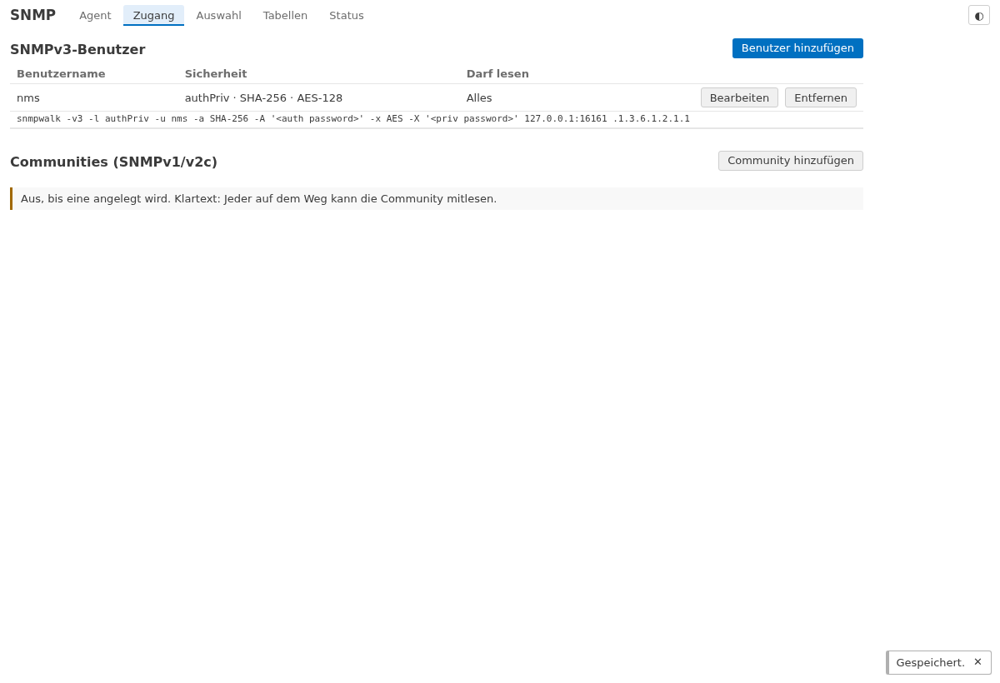

# lite-addon-snmp

*[English](README.en.md)*

Ein **SNMP-Agent** für [openccu-lite](https://github.com/hobbyquaker/openccu-lite): die Standard-MIBs eines
Linux-Hosts, die LibreNMS, Zabbix, PRTG und Checkmk abfragen, und die **Homematic-Seite** des Systems in einem
eigenen Baum – Schnittstellen mit Duty Cycle und Funkzustand, Servicemeldungen, Geräte mit Erreichbarkeit, Batterie
und Empfangsstärke. Nur lesend, SNMPv3 mit SHA-256 und AES als Standard.

> **Vorläufige OIDs.** Der Homematic-Baum liegt vorerst unter dem Experimentierbereich von net-snmp
> (`NET-SNMP-MIB::netSnmpPlaypen`, `1.3.6.1.4.1.8072.9999.9999.47621`). Er zieht auf eine eigene IANA Private
> Enterprise Number um, sobald sie vergeben ist; dann ändern sich seine OIDs. Eine Version lang beantwortet der Agent
> dann beide Bäume, und die Release Notes sagen, wann die MIB im Monitoringsystem zu ersetzen ist. Die
> Standard-MIBs sind davon nicht betroffen.



## Was es tut

- **Ein SNMP-Agent auf UDP 161**, in Go, ohne net-snmp: `Get`, `GetNext` und `GetBulk` für SNMPv1, v2c und v3.
  **Schreiben wird immer abgelehnt** (`noAccess`); es gibt keinen Codepfad, der etwas setzt.
- **SNMPv3 authPriv**: Authentifizierung SHA-256 (Standard), SHA-1, SHA-224, SHA-384, SHA-512; Verschlüsselung
  AES-128 (Standard), AES-192, AES-256. Getrennte Passwörter für beides, je mindestens 12 Zeichen; gespeichert werden
  nur die abgeleiteten Schlüssel, in einer Datei, die nur das Addon lesen kann. **v1/v2c ist aus**, bis Sie eine
  Community anlegen, und eine Community wird nur aus den eingetragenen Netzen angenommen (Standard: die lokalen).
  **Es gibt keine Voreinstellung:** ohne Benutzer und ohne Community antwortet der Agent niemandem.
- **Je Zugang eine Sicht:** alles, nur die Standard-MIBs oder nur den Homematic-Baum.
- **Standard-MIBs**, berechnet aus `/proc`, `/sys` und `statfs`, in der Form, die net-snmp unter Linux liefert:
  SNMPv2-MIB (system, `sysDescr` beginnt mit `Linux`), IF-MIB (`ifTable`, `ifXTable` mit 64-Bit-Zählern),
  EtherLike-MIB (Duplex), HOST-RESOURCES-MIB (Speicher und Dateisysteme in `hrStorageTable`, Prozessoren mit
  `hrProcessorLoad`), UCD-SNMP-MIB (Speicher, Last, `ssCpuRaw*`, `dskTable`), UCD-DISKIO-MIB und die
  Temperaturfühler (`lmTempSensorsTable`). Keine Prozessliste.
- **Der Homematic-Baum** (`LITE-SNMP-MIB`, Download auf der Seite und in jedem Release):
  - `hmSystem`: Version von openccu-lite und OpenCCU, Zustand (`ok`/`degraded`/`unknown`), Zahl der Statuswarnungen;
  - `hmInterfaceTable`: je Schnittstelle Prozess läuft, Funkmodul verbunden, Duty Cycle, Carrier Sense, Schwelle,
    Modul, Firmware, Geräte, nicht erreichbare Geräte, schwache Batterien, Servicemeldungen, Ereignisse;
  - `hmServiceMessages`: Anzahl, je Art, und jede Meldung mit Gerät, Name, Räumen und seit wann;
  - `hmDeviceTable`: je Gerät Typ, Firmware, Name, Räume, Gewerke, erreichbar, Batterie, Konfiguration ausstehend,
    RSSI, Betriebsspannung, Duty Cycle, Servicemeldungen, zuletzt gesehen;
  - `hmStatistics`: Ereignisstrom, Abonnenten, Anfragen, fehlgeschlagene Anmeldungen.

  Jede Tabelle ist über **Zeichenketten** indiziert (Schnittstelle, Adresse, Schlüssel): eine Zeile behält ihre OID
  über Neustarts und neues Anlernen hinweg, die Historie im Monitoringsystem bleibt am Gerät.
- **Auswahlen** bestimmen, welche Geräte in der Gerätetabelle stehen: Geräte und Kanäle anhaken oder ausschließen,
  dazu Regeln nach Schnittstelle, Gerätetyp, Kanaltyp, Datenpunkt (mit Platzhaltern: `LOW*`, `*_TEMPERATURE`), Raum
  und Gewerk. Der Editor zeigt live, wie viele Geräte, Kanäle und Datenpunkte passen. Es ist dasselbe Modell und
  derselbe Editor wie in [lite-addon-forwarder](https://github.com/hobbyquaker/lite-addon-forwarder).
- **Keine Funklast:** Die Werte kommen aus dem Zustandsspeicher und dem Ereignisstrom des Systems. Eine SNMP-Abfrage
  liest nur den Speicher des Agenten; der Agent ruft nie `getValue` auf und löst nie eine Funkübertragung aus.
- **Status:** Anfragen pro Minute, die letzten Quellen mit Zugang, fehlgeschlagene Anmeldungen, der Zustand der
  Datenquellen, und eine fertige `snmpwalk`-Zeile je Benutzer (ohne Passwörter).

Eine Datenpunkttabelle folgt in einer späteren Version.

## Benachrichtigungen (Traps und Informs)

Ab 0.2.0 meldet der Agent Änderungen von sich aus, als **SNMPv2c-Trap**, **SNMPv3-Trap** oder **SNMPv3-Inform**
(bestätigt, mit Wiederholung), an beliebig viele Ziele. Jede **Regel** meldet, wenn etwas auftritt, und noch einmal,
wenn es wieder weg ist:

| Regel | Benachrichtigungen |
| --- | --- |
| Servicemeldungen (nach Auswahl) | `hmServiceMessageRaised` / `…Cleared` |
| Funkmodul getrennt / verbunden | `hmInterfaceDisconnected` / `…Connected` |
| Duty Cycle (zwei Messungen über der Schwelle, zurück 10 Punkte darunter) | `hmDutyCycleHigh` / `…Normal` |
| Schnittstellendienste rfd, hmipserver, multimacd, hs485d | `hmServiceDown` / `…Up` |
| Statuswarnungen | `hmWarningRaised` / `…Cleared` |
| Geräte nicht erreichbar (nach Auswahl; aus, bis eingeschaltet) | `hmDeviceUnreachable` / `…Reachable` |

Dazu `coldStart` beim Start und, wenn eingeschaltet, `authenticationFailure`. Nach einem Neustart gilt der aktuelle
Zustand als Ausgangspunkt: es kommt keine Flut alter Meldungen. Je Ziel höchstens 20 Benachrichtigungen pro Minute
und eine Warteschlange von 1.000; ein **Test**-Knopf je Ziel sendet `hmTestNotification`. Ein SNMPv3-Trap geht mit
der Engine-ID des Agenten (Reiter *Agent*) hinaus, ein Inform mit der des Empfängers, die der Agent selbst ermittelt.
Für net-snmps `snmptrapd`:

```
createUser -e 0x<Engine-ID des Agenten> nms SHA-256 <Passwort> AES <Passwort>   # für v3-Traps
createUser nms-inform SHA-256 <Passwort> AES <Passwort>                          # für v3-Informs
authUser log nms nms-inform
```

## Installation

1. Das Paket `snmp-<arch>-<version>.tar.gz` von der [Releases-Seite](https://github.com/hobbyquaker/lite-addon-snmp/releases)
   über die Addons-Seite des Systems installieren. Das Addon steht vorerst nicht im Katalog.
2. Auf der Addon-Seite (*SNMP* im Addon-Menü oder *Einstellungen* auf der Addons-Seite) unter **Zugang** einen
   SNMPv3-Benutzer anlegen.
3. Den Port öffnen: **Addons → SNMP → Addon-Ports → UDP 161**. Er ist geschlossen, bis Sie ihn öffnen. Geöffnet ist er
   von überall erreichbar: die Regel danach auf der Seite **Firewall** auf die Adresse des Monitoringsystems
   einschränken.
4. Testen, vom Monitoringsystem aus:

   ```sh
   snmpwalk -v3 -l authPriv -u nms -a SHA-256 -A '<Passwort>' -x AES -X '<Passwort>' <system> .1.3.6.1.2.1.1
   ```

Das Addon läuft als eigener Benutzer, mit genau einem Zusatzrecht: `CAP_NET_BIND_SERVICE` für Port 161. Es liest mit
den Rechten `rpc:read`, `meta:read` und `system:read` und kann nichts schalten oder ändern.

## Im Monitoringsystem

**LibreNMS** erkennt das System als Linux (`sysDescr`) und zeigt Prozessoren, Speicher, Dateisysteme, Netzwerk und
Temperaturen. Gerät mit SNMPv3, *authPriv*, SHA-256 und AES hinzufügen. Für die Homematic-Werte die MIB
(`LITE-SNMP-MIB.txt`) in `mibs/` ablegen und z. B. `hmIfDutyCycle` oder `hmDevReachable` als eigene Sensoren
einrichten.

**Zabbix**: die Vorlage *Linux by SNMP* deckt die Standard-MIBs ab. Für die Homematic-Werte eignen sich
Low-Level-Discovery-Regeln über die Tabellen, zum Beispiel:

- Discovery `discovery[{#IFNAME},1.3.6.1.4.1.8072.9999.9999.47621.1.2.1.8]` (die Modulspalte der
  Schnittstellentabelle), Item-Prototyp `1.3.6.1.4.1.8072.9999.9999.47621.1.2.1.5.{#SNMPINDEX}` (Duty Cycle, %);
- Discovery `discovery[{#DEVNAME},1.3.6.1.4.1.8072.9999.9999.47621.1.4.1.5]` (Gerätename), Item-Prototypen
  `….1.4.1.9.{#SNMPINDEX}` (erreichbar: 1 ja, 2 nein, 3 unbekannt) und `….1.4.1.10.{#SNMPINDEX}` (Batterie schwach).

`{#SNMPINDEX}` ist der Index als Zeichenkette in OID-Form (Länge, dann die Zeichen). Die Seite *Tabellen* zeigt ihn
für jede Zeile.

## Datenschutz und Sicherheit

- Nur lesend; Schreiben wird abgelehnt und gezählt.
- Ohne Zugang keine Antwort; SNMPv3 immer mit Verschlüsselung; v1/v2c nur ausdrücklich und nur aus eingetragenen
  Netzen; je Quelle eine Ratenbegrenzung und eine Sperre nach wiederholten Fehlanmeldungen.
- Keine Verbindungen nach außen außer zu den Trap-Zielen, die Sie einrichten. Keine Telemetrie.
- Die Konfiguration liegt in `/usr/local/etc/config/addons/snmp/` (Modus 0600) und ist Teil der Systemsicherung.
  Ein Deinstallieren lässt sie für eine Neuinstallation liegen.

## Entwicklung

```sh
go test -race ./...                         # die Go-Tests, mit gosnmp als unabhängigem Client
(cd ui && npm ci && npm run check && npm test && npm run build)
(cd ui && npx playwright test)              # die Seite gegen das System-Double (scripts/dev-serve.sh)
test/interop/run.sh                         # net-snmp, snmptrapd und smilint in Docker gegen den Agenten
VERSION=0.2.0 scripts/build.sh              # die Pakete für aarch64, x86_64 und armv7l
```

`scripts/dev-serve.sh` startet den Daemon gegen ein kleines Demo-System: Seite unter
`http://127.0.0.1:18296/addons/snmp/`, Agent auf UDP `127.0.0.1:16161`.

## Lizenz

MIT. Siehe [LICENSE](LICENSE).
